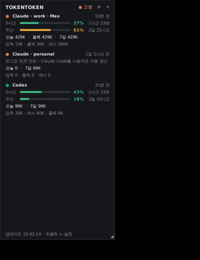
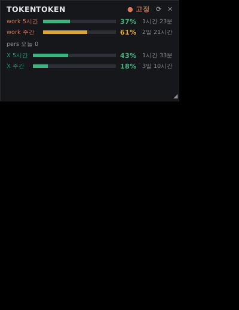

# TokenToken

Claude Code와 Codex의 토큰 사용량, 구독 한도(5시간/주간 %)를 한 화면에서 보여주는 Windows용 위젯입니다. 항상 위에 떠 있고 크기를 자유롭게 바꿀 수 있습니다. 같은 데이터를 MCP 서버로도 제공해서, Claude나 Codex에 "내 토큰 사용량 알려줘"라고 물어볼 수 있습니다.

<p>
  
  &nbsp;
  
</p>

<sub>스크린샷은 테스트 데이터로 찍었습니다.</sub>

## 주요 기능
- **항상 위 고정 위젯**: 테두리 없는 창, 드래그로 이동, ◢ 모서리로 크기 조절. 글자와 막대가 창 크기에 맞춰 커지거나 작아집니다.
- **간단 모드**: 창을 낮게 줄이면 한도 막대만 남습니다.
- **원격 PC / VM 연동**: Claude Code를 VM이나 다른 PC에서 쓰는 경우, 그쪽에서 에이전트를 실행하면 위젯이 주기적으로 가져와 함께 보여줍니다.
- **할 일 목록**: 사용량 아래에 프로젝트 목표/할 일을 적어 둘 수 있습니다. 항목마다 완료 체크와 개별 삭제가 있고, 다시 실행해도 유지됩니다.
- **Claude 계정 여러 개 지원**: `~/.claude`, `~/.claude-work`, `~/.claude-personal`처럼 `CLAUDE_CONFIG_DIR`로 나눈 계정을 각각 따로 보여줍니다.
- **Codex 지원**: Codex CLI와 VS Code 확장이 남긴 세션 기록을 읽습니다.
- **MCP 서버**: Claude Code, Codex, Claude Desktop에 자동으로 등록합니다.
- **설치 프로그램**: Python 설치 없이 동작합니다. 관리자 권한이 필요 없고, Windows 시작 시 자동 실행됩니다.
- 표준 라이브러리만 사용하며 외부 패키지가 필요 없습니다.

## 표시 항목
| 항목 | 데이터 출처 |
|---|---|
| Claude 5시간/주간 한도 % | 각 계정 폴더의 `.credentials.json` 로그인 정보로 Claude Code `/usage`와 같은 엔드포인트 조회 |
| Claude 오늘 / 현재 5시간 블록 / 최근 7일 토큰 | `<계정 폴더>/projects/**/*.jsonl` |
| Codex 5시간/주간 한도 % | `~/.codex/sessions/**/*.jsonl`의 최신 `rate_limits` |
| Codex 오늘 / 최근 7일 토큰 | 같은 Codex 세션 기록 |

이 PC에 남은 기록을 읽기 때문에 웹이나 모바일 앱에서 쓴 토큰 수는 포함되지 않습니다. 한도 %는 계정 전체 기준이며, 기본으로 **남은 비율**(100 − 사용률)을 보여줍니다. 막대 색은 사용률 기준으로 60% 미만이면 초록, 85% 미만이면 주황, 그 이상이면 빨강입니다. 우클릭 → "남은 한도(%)로 표시"를 끄면 예전처럼 사용률로 보입니다.

## 설치

### 방법 1. 설치 프로그램 (권장)
1. `TokenToken-Setup-x.y.z.exe`를 실행합니다. 설치 파일을 만드는 방법은 아래 [설치 프로그램 빌드](#설치-프로그램-빌드)를 참고하세요.
2. 설치할 항목을 고릅니다. 모두 기본으로 켜져 있습니다.
   - Windows 시작 시 자동 실행
   - 바탕화면 바로가기
   - MCP 서버 등록
3. 설치 위치는 `%LOCALAPPDATA%\Programs\TokenToken`입니다.

제거는 Windows 설정 → 앱 → TokenToken에서 합니다. 제거하면 MCP 등록과 자동 실행도 함께 해제됩니다.

> 서명되지 않은 설치 파일이라 SmartScreen 경고가 뜰 수 있습니다. "추가 정보" → "실행"을 누르세요.

### 방법 2. 소스로 실행
Python 3.9 이상이 필요합니다. python.org 설치본에는 tkinter가 포함되어 있습니다.

```bat
git clone https://github.com/AriSongYe/tokentoken.git
cd tokentoken
run.bat             :: 위젯 실행
install_mcp.bat     :: MCP 서버 등록 (해제: install_mcp.bat --remove)
```

## 사용법
- 드래그하면 창이 이동하고, 오른쪽 아래 ◢를 드래그하면 크기가 바뀝니다.
- `● 고정`을 누르면 항상 위에 고정을 켜고 끕니다. `⟳`는 새로고침, `✕`는 종료입니다.
- 우클릭 메뉴에서 바꿀 수 있는 것: 테두리 없는 모드, 투명도, 테마(다크/라이트), Claude/Codex 표시 여부, 남은 한도/사용률 표시 전환, 새로고침 주기, MCP 등록, Windows 시작 시 실행
- **할 일 목록**
  - 오른쪽 아래 `＋`를 누르고 입력한 뒤 Enter를 누르면 추가됩니다. 입력 칸이 열린 채로 남아서 여러 개를 연달아 넣을 수 있고, Esc를 누르면 닫힙니다.
  - `☐`를 누르면 완료 표시(취소선)가 되고, `✕`를 누르면 그 항목만 지워집니다. 항목을 더블클릭하면 수정할 수 있습니다.
  - 목록이 길어지면 마우스 휠로 스크롤합니다. 우클릭 메뉴에서 목록 표시 여부를 바꾸거나 완료한 항목을 한꺼번에 지울 수 있습니다.
  - 할 일은 설정 파일과 같은 폴더(`%APPDATA%\TokenToken\todos.json`)에 저장됩니다.
- 이미 실행 중이면 두 번째 창은 뜨지 않습니다.

## MCP 연동
등록되는 곳:

| 클라이언트 | 방식 |
|---|---|
| Claude Code | `claude mcp add --scope user tokentoken ...` (CLI가 없으면 `~/.claude.json`에 직접 기록) |
| Codex | `codex mcp add tokentoken ...` (CLI가 없으면 `~/.codex/config.toml`에 직접 기록) |
| Claude Desktop | `%APPDATA%\Claude\claude_desktop_config.json` (앱을 재시작해야 적용) |

제공하는 도구:

```text
get_token_usage(provider = "all" | "claude" | "codex", format = "text" | "json")
```

수정되는 설정 파일은 `*.bak_tokentoken` 이름으로 백업됩니다.

## 원격 PC / VM 연동
Claude Code를 VM이나 다른 PC에서 쓰면, 이 PC의 로그인 토큰은 갱신되지 않고 사용 기록도 남지 않습니다. 그래서 한도 %와 토큰 수가 멈춰 보입니다. 이럴 때는 Claude Code를 실제로 쓰는 쪽에서 에이전트를 실행하세요. 위젯이 새로고침 주기마다 그 값을 가져옵니다(폴링).

**1. VM / 원격 PC (Linux, Python 3.8 이상)**
```bash
git clone https://github.com/AriSongYe/tokentoken.git   # 이미 있으면 git pull
cd tokentoken
python3 tokentoken_agent.py --name vm                    # 실행해서 주소·토큰 확인 (Ctrl+C로 종료)
python3 tokentoken_agent.py --name vm --install-service  # 백그라운드 상시 실행 (systemd --user)
```
- 기본 포트는 8787이고 `--port`로 바꿀 수 있습니다. 방화벽(ufw)을 쓴다면 `sudo ufw allow 8787/tcp`가 필요합니다.
- 토큰은 `~/.config/TokenToken/agent_token`에 저장되고, `--show-token`으로 다시 볼 수 있습니다. 토큰이 없으면 `/snapshot` 요청은 401로 거절됩니다.
- 로그아웃 상태에서도 계속 돌게 하려면 한 번만 `sudo loginctl enable-linger $USER`를 실행하세요. 해제는 `--uninstall-service`입니다.
- 로그인 정보(`.credentials.json`)는 VM 밖으로 나가지 않습니다. 사용량 숫자만 전달됩니다.

**2. Windows 위젯**
우클릭 → **원격 PC(VM) 연결…**에서 주소(`http://<VM IP>:8787`), 토큰, 이름을 넣고 **연결 테스트** → **저장**을 누르세요. 그러면 `Claude · vm`처럼 칸이 하나 더 생깁니다.
- VM 네트워크는 브리지 또는 호스트 전용 어댑터여야 합니다. NAT라면 포트 포워딩이 필요합니다.
- Windows에서 Claude Code를 쓰지 않는다면 우클릭 → "이 PC 기록 표시"를 꺼서 멈춘 값을 숨길 수 있습니다.
- 원격을 여러 개 쓰려면 `config.json`의 `remote_agents`에 항목을 추가하세요.
- 연결이 끊기면 마지막 값을 보여주면서 "연결 실패 · n분 전 기준 값"이라고 표시합니다.
- MCP 서버도 같은 설정을 읽기 때문에, Claude에게 물어보면 VM 사용량까지 포함해서 답합니다.

## 설정
설정 파일 위치는 `%APPDATA%\TokenToken\config.json`이며, 우클릭 → "설정 파일 위치 열기"로 열 수 있습니다.

| 키 | 기본값 | 설명 |
|---|---|---|
| `refresh_sec` | 30 | 새로고침 주기(초) |
| `claude_api` | true | Claude 구독 한도 % 조회 여부 |
| `claude_api_interval` | 90 | 한도 조회 최소 간격(초) |
| `claude_dirs` | [] | 자동으로 찾지 못하는 Claude 설정 폴더 추가 |
| `show_idle_claude` | false | 최근 사용 기록도 유효한 로그인도 없는 계정 폴더까지 표시 |
| `remote_agents` | [] | 원격 에이전트 목록 `[{"name": "vm", "url": "http://192.168.0.63:8787", "token": "..."}]` |
| `show_local` | true | 이 PC의 Claude Code / Codex 기록 표시 |
| `show_remaining` | true | 한도를 남은 %로 표시 (false면 사용 %) |
| `show_todos` | true | 할 일 목록 표시 |
| `claude_block_limit` | 0 | 0보다 크면, 한도 API가 없을 때 5시간 블록 토큰 / 이 값으로 % 추정 |
| `alpha`, `theme`, `topmost`, `frameless`, `geometry` | | 창 설정 (메뉴에서 바뀜) |

## 참고 사항
- Claude 한도 엔드포인트(`/api/oauth/usage`)는 공식 문서에 없는 API라 바뀔 수 있습니다. 실패하면 토큰 수만 표시됩니다.
- 로그인 토큰이 만료되면 마지막으로 받은 한도 값을 "N분 전 기준"으로 보여줍니다. 그 계정으로 Claude Code를 쓰면 토큰이 갱신되고 실시간 값으로 돌아옵니다.
- 이 프로그램은 로그인 토큰을 갱신하거나 외부로 보내지 않습니다. 네트워크 요청은 Anthropic 한도 조회와, 설정한 경우 원격 에이전트 폴링뿐입니다.
- Codex 한도 %는 Codex를 마지막으로 쓴 시점의 값입니다. 리셋 시각이 지나면 0%로 표시됩니다.

## 프로젝트 구조
```text
tokenmon.pyw          위젯 (tkinter)
usage_core.py         로그 파싱, 한도 조회, 요약
tokentoken_mcp.py     MCP 서버 (stdio JSON-RPC)
install_mcp.py        Claude Code / Codex / Claude Desktop 등록
run.bat, install_mcp.bat
installer/            설치 프로그램 빌드 (NSIS + 런처)
docs/                 스크린샷
```

## 설치 프로그램 빌드
Linux(Ubuntu)에서 빌드합니다.

```bash
sudo apt-get install nsis mingw-w64 curl
bash installer/build_installer.sh   # 저장소 루트에 TokenToken-Setup-x.y.z.exe 생성
```

- [python-build-standalone](https://github.com/astral-sh/python-build-standalone)의 Windows용 Python 3.12(tkinter 포함)를 받아 `runtime/`으로 함께 넣습니다.
- `TokenToken.exe`는 `runtime\pythonw.exe -I app\tokenmon.pyw`를 실행하는 작은 런처입니다.
- 자동 실행은 `HKCU\Software\Microsoft\Windows\CurrentVersion\Run`에 등록됩니다.
